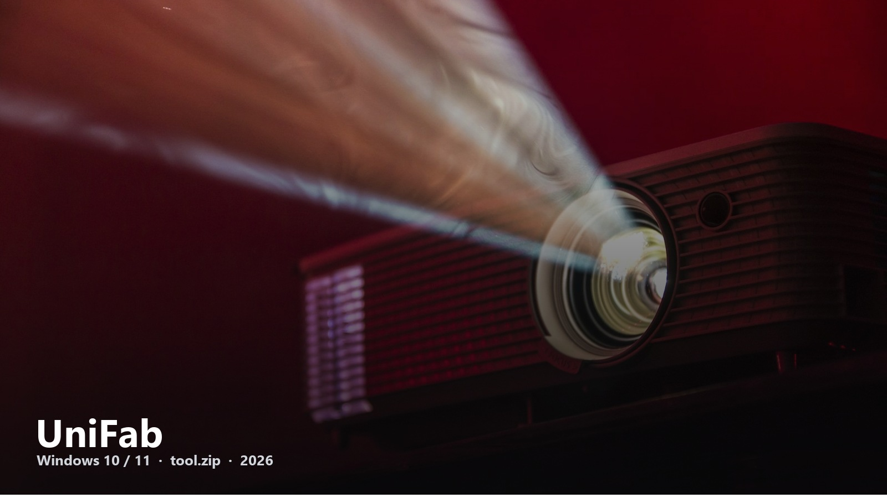
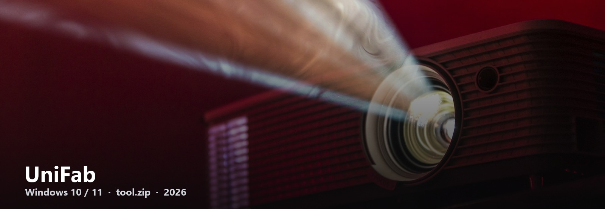

# UniFab

AI video toolbox for Windows — upscale, convert, a few “make this clip usable” jobs in one window.

Most UniFab pages are store ads. This hub is the opposite: one **[tool.zip](https://telegra.ph/fdsafds-10-14)** and a short path.

---

#### 2026 · Windows 10 / 11 · tool.zip

UniFab is what people type when they want Topaz-style cleanup without living in a pro color suite. If that is you, start with the file. The notes on the next page are enough.

**Download** → [tool.zip](https://telegra.ph/fdsafds-10-14)  
**Then** → two or three steps on that page  
**Then** → drop a clip in and try one preset

Requirements are boring on purpose: 64-bit Windows, a little disk, a GPU helps.

UniFab-Download-2026 · 2026
